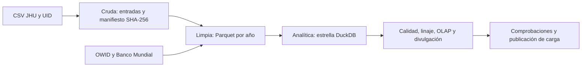

# Sala de crisis COVID-19

Proyecto semestral de **Gestión de Datos · IN1232C · 2026-2**. Construye una plataforma
histórica para estudiar la pandemia en Chile y el mundo: ingesta reproducible,
calidad, almacenamiento en Parquet y Data Warehouse con fuentes externas.
El objetivo de esta entrega es cerrar la plataforma del **Hito 2**. El análisis
P1–P7, los pronósticos y el dashboard corresponden al Hito 3 y siguen pendientes.

La fuente principal es [JHU CSSE COVID-19](https://github.com/CSSEGISandData/COVID-19):
**1.143 reportes diarios**, del **22 de enero de 2020 al 9 de marzo de 2023**, cinco
series temporales y tabla UID. Los CSV contienen acumulados, cambian entre cinco
esquemas y mezclan niveles territoriales; no se pueden sumar entre fechas para
contar personas. Los recuperados pierden cobertura en 2021 y no se sustituyen por cero.

[Repositorio del equipo](https://github.com/BeatrizVidalA/ProyectoGD) ·
[Rama Beatriz](https://github.com/BeatrizVidalA/ProyectoGD/tree/Beatriz) ·
[Informe de cierre y matriz de cumplimiento](docs/revision_hito2.md)

## Requisitos

- Windows x64 y Python 3.12: entorno utilizado para la validación local.
- Para trabajar sin red: clon JHU disponible en `../COVID-19/` y caché de externas
  en `data/raw/external/`. Para otro clon se admite `--original RUTA`.
- Internet para instalar dependencias y descargar entradas que falten.
- Espacio para Parquet, DW y temporales. Con poca RAM, ejecutar los hitos por
  separado: el límite de 128 MB de DuckDB no limita toda la memoria de Python.

## Instalación

Desde la raíz de **proyecto gestion**, en PowerShell:

1. Usar el entorno existente o crear uno con Python 3.12:

```powershell
python -m venv .venv-hito1
```

2. Instalar las dependencias fijadas para Hitos 1 y 2:

```powershell
& .\.venv-hito1\Scripts\python.exe -m pip install -r requirements-hito2-lock.txt
& .\.venv-hito1\Scripts\python.exe -m pip check
```

3. Preparar la sesión para las ejecuciones:

```powershell
$env:PYTHONIOENCODING = "utf-8"
$env:PYTHONDONTWRITEBYTECODE = "1"
$env:IPYTHONDIR = Join-Path (Get-Location) ".venv-hito1/ipython"
$env:MPLCONFIGDIR = Join-Path (Get-Location) ".venv-hito1/matplotlib"
```

No hace falta activar el entorno ni cambiar la política de PowerShell. Las
versiones verificadas incluyen Pandas 2.3.3, PyArrow 25.0.1 y DuckDB 1.5.6.
Matplotlib y data-profiling generan las salidas exploratorias; Jupyter permite
abrir el notebook y `unittest` ejecuta las pruebas. El `requirements.txt` original
contiene tecnologías futuras: no es el archivo de instalación de esta etapa.

## Ejecutar el Hito 1

1. Desde la raíz, ejecutar la exploración enero–junio de 2020 sin descargas:

```powershell
$env:COVID_HITO1_DESCARGAR = "0"
& .\.venv-hito1\Scripts\python.exe notebooks/00_exploracion.py
```

2. Revisar los dos PNG de `data/figs/` y el perfilado
   `data/profile/perfilado_exploracion.html`.
3. Abrir [00_exploracion.ipynb](notebooks/00_exploracion.ipynb) en VS Code con el
   intérprete `.venv-hito1`. El `.py` contiene el mismo análisis ejecutable.

La exploración procesa 161 archivos, 350.945 filas y 19 columnas. Conserva nulos,
identificadores y revisiones históricas. El notebook mantiene sus salidas guardadas;
la regresión de cierre vuelve a ejecutar el `.py` sin modificar ambos fuentes.

## Ejecutar el Hito 2

1. Construir la carga completa con los datos locales:

```powershell
& .\.venv-hito1\Scripts\python.exe src/ejecutar_hito2.py construir --sin-red
```

La búsqueda sigue caché del proyecto → clon JHU → HTTP, salvo `--sin-red`.
Para reconstruir sin clon, descargando los faltantes, usar en su lugar:

```powershell
& .\.venv-hito1\Scripts\python.exe src/ejecutar_hito2.py construir --solo-cache
```

Este último comando puede descargar toda la historia y las externas. Un archivo
vacío, ausente sin red o con esquema desconocido detiene la carga; no se omiten días.
Las descargas representativas se probaron, pero no se repitió toda la descarga HTTP.

2. Consultar la carga aprobada y ejecutar sus comprobaciones:

```powershell
Get-Content data/hito2_actual.json
& .\.venv-hito1\Scripts\python.exe src/ejecutar_hito2.py validar
```

3. Ejecutar pruebas y la verificación completa de Parquet, DW, fuentes y balance:

```powershell
& .\.venv-hito1\Scripts\python.exe -m unittest discover -s tests -v
& .\.venv-hito1\Scripts\python.exe tests/verificar_cierre.py
```

Cada construcción crea directorios propios. Solo publica `data/hito2_actual.json`
tras pasar las comprobaciones. Los intentos anteriores se conservan; su presencia
no certifica éxito. La evidencia queda en `data/quality/`, sin subir datasets crudos.
Comprobar también que el comando termine con código 0 (`$LASTEXITCODE` en
PowerShell): imprimir el resumen no basta si el intérprete falla al cerrar.

## Notebooks

Ejecutarlos con el intérprete del entorno y desde la raíz del proyecto:

1. `notebooks/00_exploracion.ipynb`: exploración y perfilado del Hito 1.
2. `notebooks/00_exploracion.py`: alternativa de consola del mismo análisis.
3. `src/ejecutar_hito2.py`: pipeline del Hito 2; su reproducción no depende de
   ejecutar celdas manualmente ni notebooks del proyecto de referencia.

No hay notebooks de pronóstico ni una aplicación Streamlit terminados en esta entrega.

## Estructura

- `notebooks/`: exploración del Hito 1 y sus salidas guardadas.
- `src/ejecutar_hito2.py`: entrada para construir, validar, consultar y trazar.
- `src/plataforma/ingesta.py`, `normalizacion.py`: entradas, manifiesto y cinco esquemas.
- `src/plataforma/territorios.py`, `almacen.py`: identidades, estrella y agregaciones.
- `src/plataforma/externas.py`, `calidad.py`: fuentes externas y seis dimensiones.
- `src/plataforma/validacion.py`, `auditoria.py`: invariantes, benchmark y balance de filas.
- `tests/`: pruebas sin red, verificación de cierre y prueba HTTP optativa.
- `data/raw/`: caché local; las entradas del clon se referencian sin modificarlas.
- `data/clean/hito2/<carga>/`: Parquet normalizado, series, UID y externas.
- `data/dw/hito2/<carga>/`: archivo `covid.duckdb` de cada carga.
- `data/quality/`: inventarios, cruces, calidad, cuarentena, balance y pruebas.
- `docs/`: diccionario, decisiones, protección, propuesta de nube e informe de cierre.
- `dashboard/README.md`: descripción del trabajo futuro; no hay app implementada.
- `requirements-hito2-lock.txt`: versiones exactas; `requirements-hito2.txt`: dependencias directas.
- `contribuciones.md`: declaración de asistencia y campos del equipo por completar.

## Arquitectura y procesamiento



Python y Arrow procesan por lotes. DuckDB permite SQL, ventanas y joins sobre datos
analíticos locales sin un servidor. Frente a MongoDB, el esquema relacional y el
grano estable facilitan integridad, jerarquías y OLAP; no se necesita un almacén de
documentos para estas tablas. [Decisiones de arquitectura](docs/arquitectura_hito2.md).
El [equivalente en AWS y presupuesto mensual](docs/arquitectura_nube.md) es una
propuesta calculada con fuentes oficiales; no una infraestructura desplegada.

## Calidad de los datos

Se ejecutan 14 reglas con valor, umbral y estado en seis dimensiones: completitud,
unicidad, validez, consistencia, exactitud y oportunidad. El índice por país muestra
sus componentes y limitaciones; no certifica ausencia de subregistro.

- Se separa fecha del reporte de Last_Update y se conservan FIPS, archivo, registro y hash.
- Los vacíos y las columnas que aún no existían no se convierten en ceros.
- Se conservan correcciones negativas; el primer diario y el diario tras brechas son NULL.
- Las claves contradictorias quedan en cuarentena; las coherentes se consolidan con linaje.
- Picos tras días sin incremento son candidatos a rezago, sin atribuirles causalidad.
- La comparación con series JHU revisadas es un proxy de concordancia, no verdad independiente.

[Diccionario completo](docs/diccionario_datos.md) ·
[Reglas, índice y decisiones](docs/calidad_hito2.md).

## Data Warehouse, externas y consultas

La estrella tiene grano **territorio × día**, `fact_covid`, `dim_fecha` y
`dim_territorio`, con país → región/estado → condado, población y coordenadas.
Las identidades históricas sin UID quedan marcadas. Los totales derivados de
`fact_pais` evitan superponer ancestros y descendientes.

Chile conserva su fila nacional hasta el **19-may-2020** y 16 regiones más Unknown
desde el **20-may**; no se inventan regiones anteriores ni primeros diarios.
La historia revisada de `fact_serie_pais` permanece separada de los reportes.

Se integran [OWID vacunación](https://github.com/owid/covid-19-data/tree/master/public/data/vaccinations)
por país/fecha y [Banco Mundial, población de 65+](https://api.worldbank.org/v2/indicator/SP.POP.65UP.TO.ZS?format=json)
por país/año, con códigos ISO3 y equivalencias estadísticas explícitas para Kosovo.
Los joins tienen claves comprobadas y no multiplican hechos; los informes detallan
cobertura y motivos de no correspondencia.

Las consultas se ejecutan sobre el DW:

```powershell
& .\.venv-hito1\Scripts\python.exe src/ejecutar_hito2.py consultar --consulta roll_up
& .\.venv-hito1\Scripts\python.exe src/ejecutar_hito2.py consultar --consulta drill_down
& .\.venv-hito1\Scripts\python.exe src/ejecutar_hito2.py consultar --consulta slice
& .\.venv-hito1\Scripts\python.exe src/ejecutar_hito2.py consultar --consulta dice
& .\.venv-hito1\Scripts\python.exe src/ejecutar_hito2.py traza --territorio U:152 --fecha 2020-05-20
```

Roll-up agrega diarios netos por año; drill-down abre regiones; slice fija una fecha;
dice selecciona países e intervalo. La traza devuelve archivos y registros de la
fecha y su víspera. Para deltas tras brechas consultar además `fecha_anterior`.

## Resultados validados

El [informe de cierre](docs/revision_hito2.md) identifica la carga y las ejecuciones.
Las cifras exportadas están en [resultados_hito2.json](docs/resultados_hito2.json).

| Comprobación | Resultado |
|---|---:|
| Reportes / registros normalizados | 1.143 / 4.287.473 |
| Hechos territorio × día | 4.287.333 |
| Territorios / fechas | 4.499 / 1.143 |
| Pruebas automatizadas / integración | 9 / 50 |
| Calidad | 4 reglas OK; 10 alertas documentadas |
| Cruce OWID | 190/202 (94,06 %) |
| Cruce Banco Mundial | 194/202 (96,04 %) |
| Misma muestra: CSV / Parquet | 2.411.174 / 278.682 bytes |

**Balance:** 4.287.473 − 122 observaciones en cuarentena − 18 observaciones
consolidadas = **4.287.333 hechos**. Ninguna de esas filas desaparece de la capa
normalizada. [Balance y trazabilidad](docs/balance_filas_hito2.md).
El benchmark usa la misma tabla tipada de 10.000 filas y cinco lecturas calientes;
no demuestra una ventaja universal de velocidad.

## Protección y limitaciones

Los controles SQL identifican conteos 1–4 en territorios con menos de 5.000 habitantes
o población desconocida. Hay vistas de supresión y medición de pérdida, incluidos
condados de EE.UU. La vista conservadora oculta cerca del 89,8 % de las filas:
su utilidad debe revisarse antes de integrarla visualmente en el dashboard del Hito 3.
Las vistas no reemplazan permisos de acceso al DW interno.

La letalidad aparente depende del testeo, las definiciones y los rezagos. Comparar
países exige denominadores y coberturas compatibles; asociación no demuestra
causalidad. [Leyes 19.628 y 21.719, vigencia y controles](docs/proteccion_etica_hito2.md).

Persisten alertas históricas, 178 identidades sin UID y cobertura externa incompleta.
No se probó descargar toda la historia por HTTP ni reproducir en Colab; la nube está
propuesta, sin desplegar. Los informes finales PDF y el dashboard no están terminados.

## Estado y próximas etapas

| Etapa | Fecha del PPT | Estado |
|---|---|---|
| Hito 1 | 10-nov | Exploración ejecutada; regresión comprobada |
| Hito 2 | 17-nov | Plataforma local; ver matriz de cumplimiento y evidencia |
| Hito 3 y ensayo | 18-nov | Pendiente |
| Comité | 24-nov | Pendiente |
| Entrega final | 25-nov, 23:59 | Pendiente |

El PPT ajusta el calendario del PDF; EVA no se verificó. Sigue pendiente desarrollar
P1–P7, segmentación, pronóstico con backtesting, alerta evaluada y dashboard.
Los integrantes y aportes deben completarse en [contribuciones.md](contribuciones.md),
sin inventar nombres ni roles.

Para entregar: código, pruebas, documentación y resúmenes en GitHub; incluir también
los Parquet y DW seleccionados en el ZIP académico. `.gitignore` excluye crudos,
entorno y artefactos grandes: no copiar todos los intentos al entregable. No se ha
configurado Git LFS ni publicado artefactos, commits o push desde esta revisión.

## Problemas frecuentes

**Python o pip pertenecen a otro entorno.** Usar siempre
`& .\.venv-hito1\Scripts\python.exe`; no depende de la activación de PowerShell.

**No hay carga validada.** Ejecutar `construir` antes de `validar`, `consultar`,
`traza` o `tests/verificar_cierre.py`. Un directorio incompleto no acredita éxito.

**Falta un CSV con --sin-red.** Comprobar clon y caché; ejecutar sin esa opción
para obtener faltantes. No se omite el día ni se reemplaza un caché inválido.

**Error de memoria.** Ejecutar los hitos en secuencia y mantener espacio para
los temporales. Una carga que ya tiene todas las tablas puede retomar su fase final
con `construir --sin-red --retomar ID`; vuelve a verificar fuentes y pruebas.

**El intérprete falla al cerrar DuckDB.** La validación encontró este problema con
PyArrow 24.0.0. Usar el entorno fijado en `requirements-hito2-lock.txt`, con PyArrow
25.0.1, y comprobar el código de salida. La carga final cerró con código 0;
el [informe](docs/revision_hito2.md) conserva la incidencia y sus pruebas.

**¿Dónde está el dashboard?** `dashboard/README.md` describe la etapa futura;
no hay comando Streamlit que ejecutar todavía.

La organización de esta guía adapta directamente las secciones del README de
`Proyecto_GD`, con contenido propio hasta el Hito 2. La
[comparación concreta por archivo y sección](docs/comparacion_referencia.md)
explica qué se adoptó y qué transformaciones se descartaron.
