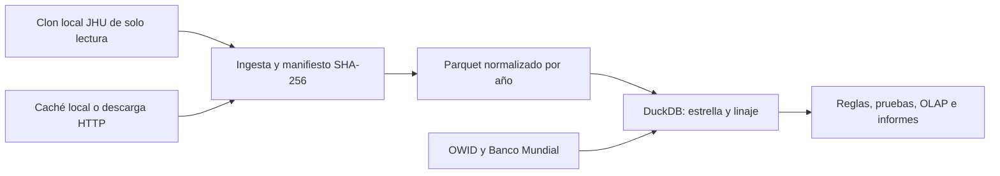

# Plataforma de datos — decisiones del Hito 2

## Capas y ejecución

Un comando construye una versión completa. Las entradas locales se referencian sin
copiar el clon: el manifiesto permite ubicar cada archivo, comprobar sus bytes y
descargarlo por su URL si falta. La capa cruda es el conjunto controlado de entradas
referenciadas más cachés locales. No es una copia descontrolada dentro del entregable.

Cada ejecución tiene directorios propios en `data/clean/hito2`, `data/dw/hito2` y
`data/quality/hito2`. `data/hito2_actual.json` se actualiza únicamente tras completar
las pruebas y verificar las huellas de las entradas. Los intentos incompletos se
conservan y no son la versión vigente. No se borran resultados anteriores.

Parquet se escribe por año y lote de archivo; no se concatena toda la historia en
un DataFrame. DuckDB carga una tabla normalizada autocontenida para que el DW no
dependa del clon o de vistas con rutas absolutas después de construido.

## Motor elegido

DuckDB ofrece SQL analítico, lectura Parquet tipada, agregaciones y ventanas, claves
de hechos y consultas locales sin servidor. Es apropiado para un equipo académico
y este volumen. El proceso limita la memoria a 768 MB y usa dos hilos para las
operaciones DuckDB; Pandas/Arrow tienen memoria adicional.

SQLite evita instalar un motor adicional, pero no ofrece esta integración directa
con Parquet. PostgreSQL sería adecuado para concurrencia y servicio centralizado,
añadiendo administración que no requiere el hito. Frente a MongoDB, los cambios
de estructura no justifican renunciar a un contrato explícito: el análisis requiere
jerarquías, uniones controladas, ventanas y agregaciones relacionales. La flexibilidad
documental no resuelve por sí misma los problemas de identidad y calidad.

No se desplegó en nube ni se estimó un costo comercial: esa mejora de excelente
de R1 queda pendiente y no se presenta como implementada.

## Estrella e identidad

`fact_covid` tiene clave primaria territorio × día y referencias a `dim_fecha` y
`dim_territorio`. Esta última contiene padre, país, nivel, población y coordenadas.
`dim_pais` es una vista de los nodos nacionales. Las unidades históricas sin match
exacto reciben una clave hash estable de su identidad publicada y metadatos faltantes;
no se les asignan población o coordenadas de una unidad moderna por semejanza.

La correspondencia usa nombres exactos o alias explícitos versionados en el código.
Un FIPS solo confirma una correspondencia con nombre y estado compatibles. Los
nombres originales permanecen en `unificada` y `bridge_nombres_historicos` registra
sus intervalos observados. No se afirma resolver toda reorganización territorial.

ISO3 no es clave única de territorio: CHL se repite entre las regiones. Las fuentes
externas se unen a la dimensión país, cuya ISO3 es única. XKS, OWID_KOS y XKX se
relacionan expresamente para Kosovo, sin declararlos ISO3166 oficiales.

`fact_pais` es una agregación derivada y separada de los hechos observados; nunca
se debe unir por UNION a sus regiones para sumar totales. `v_rollup_territorial`
expone qué filas contribuyen: si un subtotal y descendientes del mismo dominio
coexisten, se utiliza el subtotal. Dependencias con ISO propio son dominios separados
según la convención JHU. Esto no demuestra equivalencia de cobertura con OWID:
las comparaciones posteriores deben comprobarla, especialmente China/dependencias.

## Duplicados, nulos, diarios y Chile

Se conservan todas las observaciones en la tabla normalizada. En la clave canónica,
si casos y fallecidos coinciden se representa un hecho con varios orígenes. Si
contradicen, la clave queda en cuarentena: `grupos_observados.versiones>1`.
Se puede inspeccionar cada versión mediante `v_linaje`. El total país de esa fecha
queda NULL si existe un conflicto o un componente no informado; no se subestima
silenciosamente. Reglas de exactitud no eligen una versión supuestamente verdadera.

Los diarios son diferencias firmadas solo entre fechas consecutivas. Primeros
acumulados y observaciones tras brechas no se convierten en un solo día de contagios.
`delta_confirmados` y `delta_fallecidos` guardan aparte la diferencia desde la
observación anterior. Los negativos se mantienen como ajustes, no se recortan.

Chile conserva el nodo nacional hasta 19-may-2020 y regiones desde 20-may. La serie
nacional derivada cambia de sus componentes observados sin inventar regiones
anteriores; los primeros diarios regionales son NULL. Unknown contribuye a totales,
pero no permite tasas o mapas cuando carece de población/coordenadas.

La población nacional UID de Chile es 19.116.209; las 16 regiones suman 17.576.779.
La diferencia (1.539.430) se conserva, porque son denominadores de fuentes/vigencias
distintas. No se reconstruye una población nacional con la suma regional.

## Fuentes externas, referencia y linaje

Las series globales revisadas se almacenan en `fact_serie_pais` sin reemplazar los
reportes históricos. Las cinco series, incluidas las dos estadounidenses, se guardan
también en Parquet ancho. La reconciliación compara fechas y países con ambos
valores informados; un desacuerdo es trazable, no una prueba de cuál es correcto.

OWID se integra por país/fecha sin interpolación. Se conservan personas vacunadas,
esquema inicial completo y porcentajes publicados, además de código, fila y hash.
No se usan dosis totales como personas. Su historia cruda y cobertura se conservan;
el hecho integrado se restringe a la ventana JHU. Los agregados OWID no se confunden
con países. [Documentación primaria](https://github.com/owid/covid-19-data/tree/master/public/data/vaccinations).

Banco Mundial aporta SP.POP.65UP.TO.ZS, 2020–2022, en su grano anual. La vista enlaza
por país y año; no afirma medición demográfica diaria ni rellena faltantes. Se valida
que la respuesta API no tenga páginas omitidas.
[Metadatos del indicador](https://api.worldbank.org/v2/indicator/SP.POP.65UP.TO.ZS?format=json).

Para cada unión se exige unicidad en la fuente y que el número de hechos nacionales
no aumente. Los informes muestran códigos sin match, países JHU sin fuente, cobertura
y tasas de cruce. Coincidir un código no garantiza comparabilidad territorial.

`v_linaje` conecta cualquier hecho observado con archivo, fila, hash y versiones.
Los totales nacionales pueden reconstruirse con `v_rollup_territorial` y ese linaje;
los diarios requieren también el día previo. Las series usan fila y columna-fecha;
OWID y Banco Mundial conservan su registro de fuente. El comando traza muestra
orígenes de una fecha y la víspera; deltas tras brechas requieren consultar además
`fecha_anterior` (los diarios de esas brechas son NULL).

## Benchmark y límites de reproducción

El benchmark compara 10.000 registros tipados idénticos, 2.000 de cada esquema,
en CSV y Parquet ZSTD. Realiza cinco lecturas alternadas tras una lectura de
calentamiento y verifica igualdad de contenido/tipos. Son tiempos locales con caché
del sistema operativo, no una medida universal ni de almacenamiento frío.
También informa bytes de todos los CSV diarios frente a Parquet completo; esa
segunda comparación incluye cambios de representación y campos de procedencia.

La reproducción local completa y las ramas HTTP representativas se documentan
según lo realmente ejecutado en `revision_hito2.md`. Descargar otra vez los 1.143
archivos no es necesario para probar la plataforma con el clon disponible, y no
se afirma haber validado esa descarga completa ni la disponibilidad futura de URLs.
