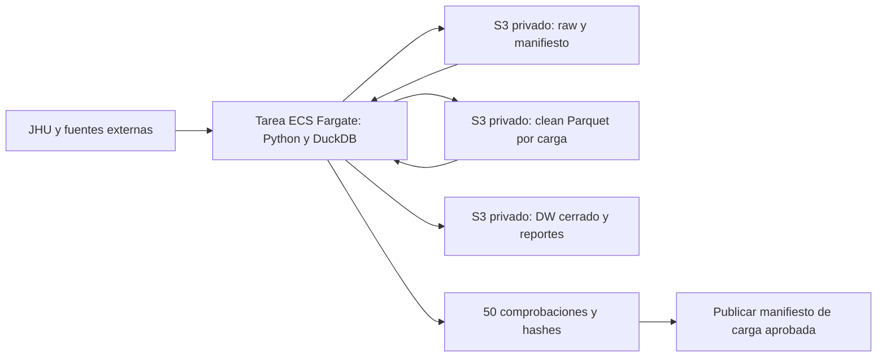

# Equivalente en nube y presupuesto mensual

Propuesta académica R1, verificada el 16-nov-2026. **No desplegada**: no se
crearon recursos, cuentas ni cargos. El enunciado, sección 3, R1, permite como
extensión un diagrama equivalente y una estimación; desplegar es otra alternativa.

## Correspondencia con la plataforma local

Una tarea bajo demanda descarga o restaura entradas en su disco efímero y ejecuta
el mismo pipeline. Mantiene DuckDB en disco local durante la carga; **no abre un
archivo DuckDB sobre S3 ni admite varios escritores simultáneos**. Solo después
del checkpoint y las pruebas carga Parquet, DW y evidencias en prefijos versionados
y publica el manifiesto aprobado. Consultar otra vez requiere restaurar una copia
local de solo lectura. Esto conserva el modelo estrella; Athena sería una variante
con exportación de hechos/dimensiones y adaptación SQL, fuera de esta propuesta.

Correspondencia: `data/raw` → S3 `raw/`; `data/clean` → S3 `clean/`;
`data/dw` y `data/quality` → S3 `analytic/` y `quality/`. El rol de tarea debe tener
lectura de entradas y escritura solo de su carga; bucket privado, bloqueo de
acceso público, cifrado y sin credenciales en código. La descarga cruda a S3 es
almacenamiento del pipeline, no publicación de datasets en GitHub.

La adaptación futura necesita imagen Linux, sincronización S3, rol IAM y definición
de tarea; no se presenta como infraestructura ejecutada. Se presupuestan 2 vCPU,
8 GB RAM y 20 GB efímeros incluidos. El ajuste real de RAM/disco y duración requiere
medir en Linux; 128 MB limita DuckDB, no toda la tarea.

## Hipótesis y cálculo

Región **us-east-1, N. Virginia**, Linux/x86, dólares estadounidenses, sin impuestos,
descuentos ni créditos. Mes de 30 días. El conjunto histórico está cerrado: se
presupuestan **10 horas de tarea al mes** para reconstrucciones y consultas
académicas; no un servicio encendido 24/7. S3: 10 GB-mes incluyendo una carga
seleccionada, fuentes y margen; no todos los intentos locales. Tráfico interno
en una región, sin balanceador, NAT Gateway ni replicación entre regiones.

| Concepto | Precio usado | Volumen mensual supuesto | USD |
|---|---:|---:|---:|
| Fargate CPU | 0,000011244 / vCPU-s | 2 × 36.000 s | 0,809568 |
| Fargate RAM | 0,000001235 / GB-s | 8 × 36.000 s | 0,355680 |
| IPv4 pública durante tareas | 0,005 / h | 10 h | 0,050000 |
| S3 Standard, primer tramo | 0,023 / GB-mes | 10 GB-mes | 0,230000 |
| S3 PUT/COPY/POST/LIST | 0,005 / 1.000 | 2.000 solicitudes | 0,010000 |
| S3 GET y otras | 0,0004 / 1.000 | 20.000 solicitudes | 0,008000 |
| Subtotal calculado | | | **1,463248** |
| Reserva para imagen, logs y eventual salida | Asignación presupuestaria, no tarifa de AWS | 2 USD | **2,000000** |
| Presupuesto orientativo | Subtotal + reserva, redondeado hacia arriba | | **3,47 USD/mes** |

La reserva no garantiza cubrir cualquier transferencia: una descarga masiva,
retener múltiples versiones o tareas continuas cambia el presupuesto. Para otro
escenario: `CPU = vCPU × segundos × tarifa`, `RAM = GB × segundos × tarifa` y
`S3 = GB-mes × tarifa + solicitudes`. Con las mismas hipótesis, cada hora adicional
de tarea agrega aproximadamente 0,121525 USD de CPU, RAM e IPv4. Un servicio 24/7
no debe presupuestarse con las diez horas de este ejemplo.

## Fuentes y evidencia de tarifas

- [Fargate, ejemplo 1 y duración](https://aws.amazon.com/fargate/pricing/):
  CPU/RAM por segundo en N. Virginia y 20 GB efímeros incluidos.
- [VPC, IPv4 pública](https://aws.amazon.com/vpc/pricing/): tarifa por dirección/hora.
- [S3, precios y unidades](https://aws.amazon.com/s3/pricing/): GB binarios,
  almacenamiento y solicitudes.
- [Catálogo público oficial S3 us-east-1](https://pricing.us-east-1.amazonaws.com/offers/v1.0/aws/AmazonS3/current/us-east-1/index.json):
  se consultó directamente la publicación `2026-11-16T07:13:00Z`; el extracto de
  tarifas se conserva en [tarifas_s3.json](tarifas_s3.json).

Los precios cambian. Recalcular en la región elegida antes de desplegar; no se
requiere desplegar ni gastar dinero para reproducir la plataforma local.
